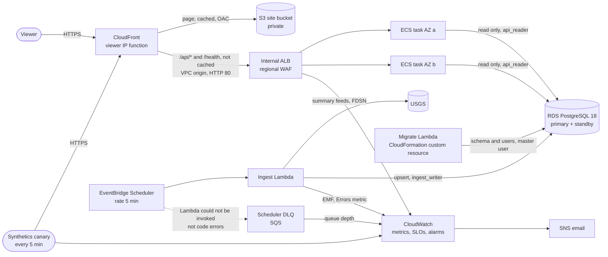
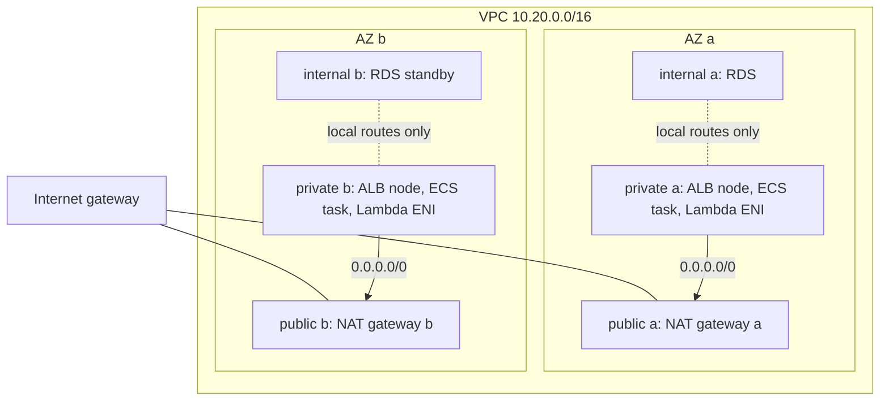

# Global Earthquake Monitoring System: architecture and operations

This document describes how the system is built, how it fails, how we know it is healthy, and what an operator does about it. Every number comes from a template in `infra/`, a script in `ops/`, a measurement against the deployed stack, or a cited source.

## 1. Overview

The system ingests USGS earthquake data every 5 minutes into PostgreSQL and serves three reports through a web page and a JSON API:

| Report | Endpoint | Definition |
| --- | --- | --- |
| Significant earthquakes | `GET /api/quakes/significant` | Magnitude strictly above 4.0 with `event_time` in the last 24 hours, newest first |
| Daily average | `GET /api/stats/daily-average` | Earthquakes per day over the 7 complete UTC days before today, with the per-day counts |
| Historical search | `GET /api/quakes/search?start&end&min_mag&limit` | Largest first in `[start, end)`; defaults to the top 5 of the last 30 days; ranges up to 366 days |

Only events whose USGS `type` is `earthquake` count (see section 12).

Each layer is a nested CloudFormation stack under one root stack: network, database, alb, ingestion, app, edge, observability. The alb stack (load balancer, target group, listener, WAF) depends only on the network, so the edge stack is created while the database is. A separate bootstrap stack holds the artifacts bucket and the image repository.

## 2. Request path and data path

**Request path.**

1. The viewer connects to CloudFront over HTTPS (HTTP is redirected).
2. The page (`index.html`, `app.js`, `style.css`) comes from a private S3 bucket that only this distribution can read, through origin access control. CloudFront caches it with the managed `CachingOptimized` policy and `deploy.sh` invalidates it on every deploy.
3. `/api/*` and `/health` are never cached (managed `CachingDisabled`). A CloudFront Function on viewer request writes `x-viewer-ip` from `event.viewer.ip`, overwriting anything the client sent.
4. CloudFront reaches the internal ALB through a VPC origin. The ALB security group accepts port 80 only from the CloudFront origin-facing managed prefix list.
5. The regional WAF on the ALB applies a rate rule keyed on `x-viewer-ip` and two AWS managed rule groups.
6. An ECS task answers from a pool of 4 connections, as the read-only user `api_reader`, over TLS with `sslmode=verify-full` against the RDS CA bundle. Each statement has a 2-second timeout.

**Why the API is not cached.** This is a monitoring page. A cached copy of "earthquakes in the last 24 hours" can keep saying there are none while the data behind it is stale or the database is down. Every report, `/health` and the 503 carry `Cache-Control: no-store`, and CloudFront caches nothing under `/api/*` or `/health` whatever the headers say; when the database is down the API returns `503` and the page says the section could not load. Failing visibly is the point. Every report includes `data_age_seconds`: the time since USGS generated the feed behind the newest successful ingestion. The page turns it into "updated N minutes ago" and shows a delay banner above 15 minutes.

**Why CloudFront still fronts the API.** HTTPS. ACM issues public certificates only for domain names you prove you control, and the stack has no domain, so the ALB cannot serve HTTPS itself; an HTTP API behind an HTTPS page would also be blocked by browsers as mixed content. CloudFront's default certificate covers the `*.cloudfront.net` name, the page and the API share one origin (no CORS), and the ALB stays internal. With a domain, the API could go straight to an internet-facing ALB with an ACM certificate and the WAF, and CloudFront would serve only the page.

**Data path.**

1. EventBridge Scheduler invokes the ingest Lambda every 5 minutes. Async retries are 0 and events older than 240 s are dropped, so runs never stack; Scheduler retries delivery twice within 240 s and sends what it cannot deliver to an SQS dead-letter queue. That queue belongs to the schedule, not to the function: it receives an event only when Scheduler cannot invoke the Lambda, for example a missing permission or a deleted function. An error inside the function code does not reach it; that shows up in the Lambda `Errors` metric and the `ticket-ingest-errors` alarm, and the next run 5 minutes later is the retry.
2. The Lambda takes a PostgreSQL advisory lock; a second concurrent run returns `skipped`. Account concurrency is 10 in a new account and Lambda only lets you reserve down to 100 unreserved, so the lock, not reserved concurrency, guarantees one writer.
3. It picks the smallest source that covers the gap since the last feed it loaded, with one hour of margin: `all_day` under 23 hours, `all_week` under 6 days 23 hours, `all_month` under 29 days 23 hours, otherwise the FDSN event service in 30-day windows. A window that returns the 20,000-row limit is split in half until it fits.
4. Features without an id, times or valid coordinates are skipped and counted. URLs are kept only if they point to `https://earthquake.usgs.gov/`.
5. Rows are upserted by USGS id. A row is overwritten only when the incoming `updated` is newer.
6. The run records the feed generation time and emits Embedded Metric Format lines: `DataLagSeconds`, `IngestSuccess`, `EventsUpserted`, `EventsSkipped`.

The migration runs inside the stack operation as a CloudFormation custom resource, and the schedule depends on it, so no run ever reaches an unmigrated database; a failed migration fails the stack. Once the stack is up, `deploy.sh` runs 13 backfill windows of 30 days (390 days) through FDSN when the oldest stored event is younger than 360 days, then one scheduled run.

## 3. Security

**Network.** Three tiers per AZ. Public subnets hold only the NAT gateways. Private subnets hold the internal ALB, the ECS tasks and the Lambda ENIs, with a default route to the NAT in the same AZ. Internal subnets hold RDS and share a route table with no default route: the database cannot reach or be reached from outside the VPC, and its security group accepts port 5432 only from the API tasks and the two Lambdas. Rejected traffic is logged by VPC flow logs to `/<stack>/vpc/rejected` (7 days).

**Security group chain.** No group keeps the default allow-all egress.

| Group | Inbound | Outbound |
| --- | --- | --- |
| ALB | TCP 80 from the CloudFront origin-facing prefix list | TCP 8000 to the app group |
| App (ECS tasks) | TCP 8000 from the ALB group | TCP 5432 to the DB group; TCP 443 to any address (ECR, CloudWatch Logs, Secrets Manager through NAT) |
| Lambda | none | TCP 5432 to the DB group; TCP 443 to any address (USGS, Secrets Manager through NAT) |
| DB | TCP 5432 from the app and Lambda groups | none |

**IAM.** No `Action: "*"`. `Resource: "*"` appears only for actions without resource-level permissions, each with a comment in the template.

| Role | Actions | Resources | Why |
| --- | --- | --- | --- |
| Migrate Lambda | `logs:CreateLogStream`, `logs:PutLogEvents`; `secretsmanager:GetSecretValue` | its log group; master, `api_reader` and `ingest_writer` secrets | creates the schema and the two users |
| Ingest Lambda | same log actions; `secretsmanager:GetSecretValue` | its log group; the `ingest_writer` secret | writes events and state |
| Both Lambdas (managed policy) | EC2 ENI actions, with a `Deny` when `lambda:SourceFunctionArn` is set | `*` (the Describe calls have no resource scope) | the Lambda service can attach ENIs; function code cannot |
| ECS execution role | `ecr:GetAuthorizationToken`; image pull actions; log actions; `secretsmanager:GetSecretValue` | `*` for the token; this repository; this log group; the `api_reader` secret | pull the image, ship logs, inject the password |
| ECS task role | none | | the app calls no AWS API |
| Scheduler | `lambda:InvokeFunction`; `sqs:SendMessage` | the ingest function; the DLQ | run ingestion, record failed deliveries |
| Flow logs | log write actions; `logs:DescribeLogGroups` | the flow log group; log groups in this account and region | deliver rejected-traffic records |
| Canary | `s3:PutObject`, `s3:GetObject` under `canary/`; `s3:GetBucketLocation`; `s3:ListAllMyBuckets`; log actions; `cloudwatch:PutMetricData` limited to the `CloudWatchSynthetics` namespace | the artifacts bucket; `/aws/lambda/cwsyn-<stack>-canary-*` | store results, write logs and metrics |

Trust policies for flow logs, the ECS execution role and Scheduler carry `aws:SourceAccount` conditions. The SNS topic policy accepts publishes only from CloudWatch alarms in this account.

**Database users.** `api_reader` can only `SELECT`. `ingest_writer` can `SELECT`, `INSERT`, `UPDATE` the events table and `SELECT`, `UPDATE` the state table; it cannot delete or create objects. `PUBLIC` is revoked from schema `public`. Tests assert that neither user owns a table or has superuser, `BYPASSRLS`, create-role or create-database. Row level security does not apply: one public dataset, no tenants.

**Secrets.** RDS generates and holds the master password in Secrets Manager; only the migration Lambda reads it. The two application passwords are generated by Secrets Manager. The migration sends PostgreSQL a SCRAM-SHA-256 verifier computed on the client, never the password, so a statement that ends up in the database log holds no secret; a test checks this. ECS receives the reader password through task definition `Secrets`, never as a plain environment variable. No secret appears in stack outputs, code or logs.

**TLS.** Viewers use HTTPS with the default CloudFront certificate. The API and the Lambdas connect to RDS with `sslmode=verify-full`; the parameter group sets `rds.force_ssl=1`. Storage is encrypted.

**WAF.** Three rules on the ALB:

- `rate-limit-per-viewer`: blocks an `x-viewer-ip` that sends more than 300 requests in 5 minutes. The key is that header because every request reaches the ALB from CloudFront addresses; the CloudFront Function overwrites the header, so a client cannot pick its own key.
- `AWSManagedRulesCommonRuleSet` and `AWSManagedRulesKnownBadInputsRuleSet`.

The distribution is IPv4 only: the documentation does not say how `event.viewer.ip` or the WAF forwarded-IP key handle IPv6 addresses.

**Personal data.** The only personal data held is viewer IP addresses: in the API access log (`/<stack>/ecs/api`, 14 days) to investigate abuse and incidents and to verify the rate limit, and in rejected-traffic flow logs (7 days). Nothing else about viewers is stored.

**Known gaps, accepted.**

- CloudFront to ALB is HTTP inside AWS. TLS to the origin needs a certificate for a domain we own.
- The default CloudFront certificate fixes the viewer TLS policy.
- App and Lambda tiers can open TCP 443 to any address. Interface endpoints for ECR, Logs and Secrets Manager would close that at USD 0.01 per endpoint-hour (Price List, us-east-2), for four endpoints in two AZs.
- The Lambdas use the boto3 that ships with the runtime.

## 4. High availability and failure modes

| Component | Failure | User effect | Detection | Recovery |
| --- | --- | --- | --- | --- |
| ECS task | crash or AZ loss | none; the other task serves | `ticket-unhealthy-tasks` | ECS replaces the task |
| Deployment | new image fails health checks or returns 5xx | none; old tasks keep serving | circuit breaker, `deploy-target-5xx` alarm | automatic rollback |
| RDS primary | instance or AZ failure | reports return 503 until the failover completes (typically 60 to 120 s per AWS) | `/health`, canary, availability SLO | Multi-AZ failover |
| NAT gateway | AZ loss | none for the other AZ | Lambda or task errors in one AZ | one NAT per AZ |
| USGS | outage or bad response | data ages, delay banner, reports keep answering | freshness SLO, `ticket-ingest-errors` | next scheduled run catches up by lag |
| Scheduler | delivery failure | data ages | `ticket-schedule-dlq` | next run |
| Abusive client | request flood | that IP gets 403 | WAF `BlockedRequests` | block lifts when the rate drops |
| CloudFront or DNS path | edge failure | site unreachable | `page-canary-failing` | AWS |

These are design behaviors. None of these failures has been injected on purpose yet.

## 5. SLIs and SLOs

All three SLOs use a rolling 30-day interval and live in CloudWatch Application Signals.

| SLO | Type | SLI | Goal | Burn-rate windows (min) |
| --- | --- | --- | --- | --- |
| `<stack>-api-availability` | request-based | bad = target 5xx + ELB 5xx; total = `RequestCount` + ELB 5xx; Sum per 60 s | 99.9% | 5, 30, 60, 360, 4320 |
| `<stack>-api-latency` | period-based, 60 s | p95 `TargetResponseTime` at or under 0.3 s; a minute without traffic counts as good | 99% | 5, 30, 60, 360, 4320 |
| `<stack>-data-freshness` | period-based, 600 s | maximum `DataLagSeconds` at or under 600 s; a period without data counts as bad | 99% | 10, 30, 60, 360, 4320 |

Why these targets:

- **Availability 99.9%.** One region, two AZs, a managed database with failover measured in minutes. 99.9% leaves 43 minutes a month, enough for one failover and one bad deploy, not for repeated ones.
- **Latency 300 ms at p95, 99% of minutes.** The three report queries run in under 2 ms on a year of synthetic rows with `EXPLAIN ANALYZE`. 300 ms covers pool waits, a cold connection and TLS to the database without letting a real regression hide.
- **Freshness 600 s, 99% of 10-minute periods.** USGS regenerates the summary feeds every minute and we ingest every 5 minutes, so 600 s means two runs in a row failed. The period is 10 minutes, not 5, because a 5-minute schedule can leave a 5-minute period without a datapoint, and the SLI counts missing data as bad.

**Error budget arithmetic** (30 days = 43,200 minutes):

- Availability: the budget is 0.1% of requests. At constant traffic, a full outage spends it in 0.001 × 43,200 = 43.2 minutes.
- Latency: 1% of 43,200 one-minute periods = 432 bad minutes (7.2 hours).
- Freshness: 1% of 4,320 ten-minute periods = 43 bad periods (about 7.2 hours).
- Burn-rate thresholds (SRE Workbook, "Alerting on SLOs", table 5-8): 14.4 = 2% × 720 h / 1 h; 6 = 5% × 720 h / 6 h; 1 = 10% × 720 h / 72 h.

**Known approximations.**

- ALB metrics do not see CloudFront errors. The canary covers the edge path.
- ALB does not count every load-balancer-generated error in `RequestCount`, so the total adds ELB 5xx. A few errors may be counted twice, which slightly understates the bad ratio.
- **Low traffic.** Without users, the canary's 4 API requests every 5 minutes (48 an hour) are all the traffic, so a single 5xx is 2% of the hour: a 60-minute burn rate of 20.8 and a 5-minute one of 250, both above 14.4, and the fast-burn page fires. The SRE Workbook describes the same effect ("Alerting on SLOs", low-traffic services) and lists the ways out: artificial traffic, combining services, making a single failure matter less, or a lower SLO or longer window. With real users the same error is a smaller share. Until then a page can mean one failed request, and the availability runbook has a row for that case.

## 6. Error budget policy

Based on the SRE Workbook, "Appendix B: Example Error Budget Policy".

- Budget remaining in the 30-day window: ship normally.
- Budget exhausted: freeze releases except P0 and security fixes until the window recovers. The Workbook puts it as: "halt all changes and releases other than P0 issues or security fixes". The cause becomes the top item of the next sprint.
- One incident spends more than 20% of a budget: a blameless postmortem is mandatory (`docs/postmortem-template.md`).
- Freshness budget spent by a USGS outage: review whether the SLO measures what we control. No freeze, because no release of ours caused it.
- Disagreements about the calculation or the action go to the engineering lead.

## 7. Alerting

One SNS topic, email subscription. The alarm name carries the severity: `page-*` means act now, `ticket-*` means handle in working hours. Every alarm notifies on ALARM and on OK, and every description names its runbook.

**Burn-rate alarms (9).** One metric alarm per window pair and SLO, firing on `MIN([long, short]) > threshold`, so both windows must burn:

| Alarm | Long / short window | Threshold | Severity |
| --- | --- | --- | --- |
| `<stack>-page-<slo>-fast-burn` | 60 / 5 min (freshness 60 / 10) | 14.4 | page |
| `<stack>-page-<slo>-slow-burn` | 360 / 30 min | 6 | page |
| `<stack>-ticket-<slo>-budget-burn` | 4320 / 360 min | 1 | ticket |

`<slo>` is `availability`, `latency` or `freshness`.

**Operational alarms (7).**

| Alarm | Condition | Runbook |
| --- | --- | --- |
| `page-canary-failing` | canary success below 100% in 2 of 3 five-minute periods; no data counts as failing | `canary.md` |
| `ticket-ingest-errors` | ingest Lambda errors in 3 of 3 five-minute periods | `data-freshness.md` |
| `ticket-schedule-dlq` | any message in the Scheduler DLQ | `data-freshness.md` |
| `ticket-unhealthy-tasks` | an unhealthy target for 5 minutes | `api-availability.md` |
| `ticket-db-cpu` | RDS CPU above 80% for 15 minutes | `database.md` |
| `ticket-db-storage` | free storage below 2 GiB | `database.md` |
| `ticket-db-memory` | freeable memory below 100 MiB for 15 minutes | `database.md` |

The app stack adds `<stack>-deploy-target-5xx`, used by ECS to roll back a deployment.

Every alarm sends both ALARM and OK to the same topic. Forcing an alarm with `aws cloudwatch set-alarm-state` proves that delivery works, not that the condition is right.

## 8. Graceful degradation

- **USGS down.** Ingestion fails and pages through the freshness SLO. The API keeps serving the last data with its age; the page shows the delay banner. No user sees an error.
- **Database down.** Reports fail with 503 and the page says so; nothing pretends to be current. `/livez`, the ALB health check, does not touch the database, so the fleet stays registered and recovers the moment the database does. `/health` reports `degraded`.
- **One AZ down.** The second NAT gateway keeps the other AZ's egress, the second task serves, RDS fails over to the standby.
- **Bad deploy.** The circuit breaker and the 5xx alarm roll the service back while the old tasks keep serving.
- **Traffic spike.** CloudFront serves the page from its cache. Every API request reaches the ALB, where the WAF caps each viewer at 300 requests in 5 minutes and CPU target tracking scales from 2 to 4 tasks.

## 9. Toil reduction

The SRE book defines toil as work that is "manual, repetitive, automatable, tactical, devoid of enduring value, and that scales linearly as a service grows", and sets a goal of keeping it "below 50% of each SRE's time" (Site Reliability Engineering, "Eliminating Toil").

| What a human no longer does | Mechanism |
| --- | --- |
| Set up a new account by hand | `ops/preflight.sh` checks tools, credentials, quotas and name collisions; `ops/deploy.sh` does the rest in one run and converges when rerun |
| Load history | `deploy.sh` runs an idempotent 390-day backfill when history is short |
| Recover a long ingestion gap | feed choice by lag; FDSN windows beyond 30 days |
| Clean up and hunt for leaks | `ops/destroy.sh --region <region> --purge` then `ops/audit.sh --region <region>`, which exits 1 if anything is left |
| Find manual changes | `ops/drift.sh` on the root and every nested stack |
| Rotate or share the master password | RDS manages it; no human reads it |
| Triage noisy alerts | multiwindow burn rates, so a spike that has stopped does not page; at canary-only traffic one 5xx still does (section 5) |
| Look up what to do | every alarm description links its runbook |

## 10. Incident response

| Severity | Meaning | Response |
| --- | --- | --- |
| SEV1 | users see an outage or wrong data | page, incident commander named, status updates every 30 minutes |
| SEV2 | an SLO budget is burning fast (page alarms) | page, one responder, escalate to SEV1 if users are affected |
| SEV3 | ticket alarms | next working day |

Roles follow the SRE book chapter "Managing Incidents": the incident commander "holds the high-level state about the incident"; the operations lead is the only person changing the system; communications keeps stakeholders informed; planning handles longer-term work such as tickets and handoffs.

First 15 minutes:

1. Acknowledge the page; name the incident commander.
2. Open the dashboard (`<stack>`), check which SLO is burning and since when.
3. Follow the runbook linked from the alarm.
4. Decide: roll back, fail over, or wait for a dependency (USGS).
5. Write the first timeline entry in UTC.

After: `docs/postmortem-template.md` when a single incident spends more than 20% of a budget.

## 11. Cost

Hourly cost of the full stack in us-east-2, from the AWS Price List values gathered on 2026-10-22:

| Component | USD per hour |
| --- | --- |
| 2 NAT gateways (0.045 each) | 0.090 |
| RDS `db.t4g.micro` Multi-AZ | 0.032 |
| ALB (plus LCUs) | 0.0225 |
| 2 Fargate tasks, 0.25 vCPU and 0.5 GB, ARM | 0.020 |
| 2 public IPv4 addresses on the NATs (0.005 each) | 0.010 |
| Synthetics canary every 5 minutes | 0.014 |
| WAF web ACL (USD 5 a month) | about 0.007 |
| S3 site bucket and CloudFront at this traffic | under 0.001 |
| **Total** | **about 0.20** |

Data transfer, NAT data processing, CloudWatch metrics and logs add cents at this traffic. `ops/destroy.sh --region <region> --purge` removes every billable resource, and `ops/audit.sh` printing `audit clean` is the proof.

## 12. Additional insights

- **Not every event is an earthquake.** The "all" feeds include quarry blasts, explosions and other event types. The reports count only `type = earthquake`; the rest is stored as received.
- **USGS revises events.** Magnitudes and locations change after the first report. The upsert keeps the row with the newest `updated`. A revision of an event that has dropped out of the feed window is not picked up; reconciliation is out of scope.
- **Feeds first, FDSN for gaps.** The FDSN event service asks that "automated applications should use Real-time GeoJSON Feeds" whenever possible, so FDSN is used only for the backfill and for gaps longer than a month.
- **The 20,000-event limit.** FDSN rejects a query that matches more than 20,000 events with HTTP 400, unless the query sets `limit`. With `limit=20000` it answers 200 with the first 20,000 (checked on 2026-10-22: 90 days matched 35,889 events). The ingester always sets the limit and halves any window that comes back full; 30-day windows hold about 12,000 events.
- **Feed time, not clock time.** Freshness is measured from the time USGS generated the feed, so a run that succeeds against a stale feed does not hide the delay.
- **Multi-region** would need a second region with its own stack, cross-region read replica or logical replication, and a failover decision at the DNS or CloudFront origin group level.
- **TLS to the origin** needs a custom domain, an ACM certificate on the ALB and `https-only` on the VPC origin.
- **More traffic.** Measured on the deployed stack: report queries take 0.1 to 1.5 ms with `EXPLAIN ANALYZE` and RDS CPU sits between 7% and 13%, so the database is not the limit today. The order to scale it: RDS Proxy first (connection pooling across many tasks and Lambdas, and it keeps application connections through a failover; USD 0.015 per vCPU-hour in us-east-2, so 0.03 for this instance), then a read replica for `api_reader`, then more tasks; the WAF limit would move to per-path rules. A cache in front of the database is not on that list, for the same reason the API is not cached.

## 13. Out of scope, on purpose

| Item | Reason |
| --- | --- |
| Multi-region disaster recovery | the brief asks for one region |
| Reconciling events USGS deletes | needs a periodic full comparison; does not change the three reports materially |
| Automatic rotation of the application passwords | a rotation Lambda per user; the master password is already managed by RDS |
| TLS between CloudFront and the ALB | needs a custom domain |
| A cache in front of the database | stale answers are the failure this design avoids; the queries are already fast |
| Login | the data is public and read-only |
